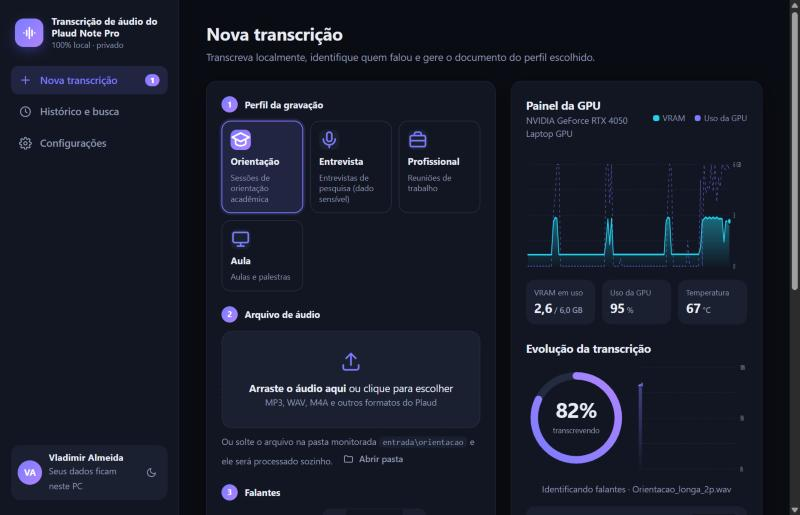
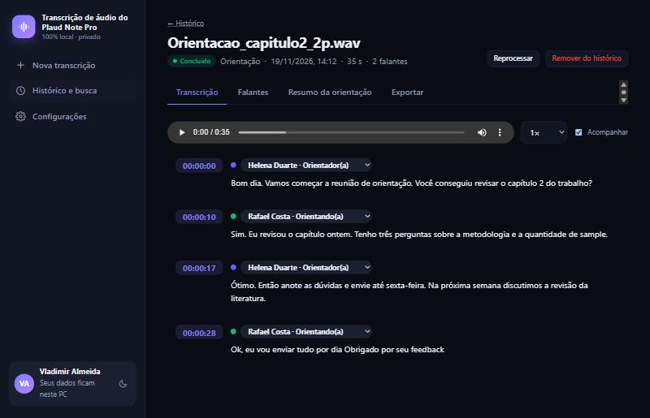
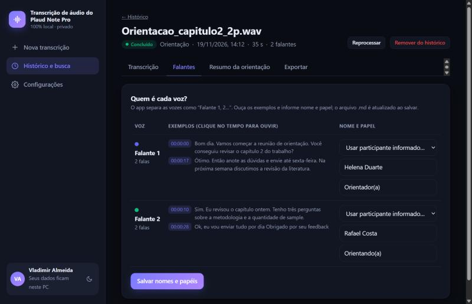
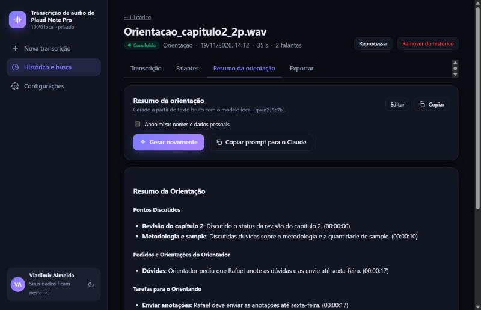
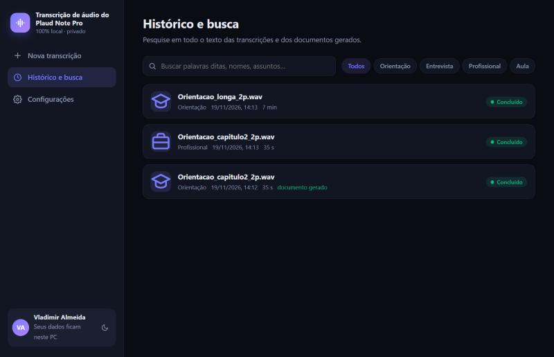

# Transcrição de áudio do Plaud Note Pro

Painel web **100% local** para transcrever gravações do Plaud Note Pro, separar quem falou e gerar o documento
certo para cada tipo de gravação (ata, resumo de orientação, notas de aula, codificação de entrevista).
Nada sai do seu computador: transcrição, separação de falantes e o modelo de linguagem rodam na sua placa NVIDIA.

*Por Vladimir Almeida.*



## O que faz

| | |
|---|---|
| **Quatro perfis** | Orientação, Entrevista, Profissional (reuniões) e Aula. Cada um tem seus papéis de falantes e seu prompt. |
| **Duas formas de entrada** | Enviar o áudio pelo painel (arrastar e soltar) **ou** soltar o arquivo na pasta `entrada\<perfil>`: a detecção é automática. |
| **Falantes** | Escolha o número de pessoas (ou automático), informe nome e papel e depois confirme quem é cada voz ouvindo exemplos. |
| **Transcrição** | Whisper `large-v3-turbo` na GPU, português, com tempos por fala. |
| **Documento contextualizado** | Um LLM local (Ollama) transforma o texto bruto na ata/resumo/notas do perfil. Prompts editáveis. |
| **Acompanhamento** | Anel de progresso, gráfico da evolução em %, estimativa de tempo e gráfico da VRAM, uso e temperatura da GeForce. |
| **Editor com áudio** | Clique numa fala para ouvir o trecho; corrija o texto e troque o falante de um turno. |
| **Histórico e busca** | Busca em todo o texto (sem diferenciar acentos), por perfil. |
| **Anonimização** | Para entrevistas: troca nomes e dados pessoais por códigos, com tabela de correspondência local. |
| **Exportação** | Markdown, Word (.docx), nota no cofre do Obsidian e cópia do prompt pronto para colar no Claude. |

<table>
<tr><td></td><td></td></tr>
<tr><td></td><td></td></tr>
</table>

## Requisitos

- Windows 11, placa NVIDIA com **6 GB de VRAM ou mais** (desenvolvido numa RTX 4050 Laptop) e driver atualizado.
- Notebook **na tomada** durante o processamento.
- Python 3.12, FFmpeg e Ollama (instalação abaixo).

## Instalação

Passo a passo completo, incluindo a conta no Hugging Face: [docs/instalacao.md](docs/instalacao.md). Resumo:

```powershell
winget install Python.Python.3.12
winget install Gyan.FFmpeg.Essentials
winget install Ollama.Ollama
ollama pull qwen3:4b-instruct-2507-q4_K_M

py -3.12 -m venv .venv
.venv\Scripts\python -m pip install torch==2.11.0 torchaudio==2.11.0 --index-url https://download.pytorch.org/whl/cu128
.venv\Scripts\python -m pip install -r requirements.txt
.venv\Scripts\python -m pip install -e . --no-deps
```

O download dos modelos de falantes exige um token somente leitura do Hugging Face **uma única vez**
([como fazer](docs/instalacao.md#modelos-de-falantes-uma-vez)). Depois disso tudo roda offline.

## Uso diário

Dê duplo clique em **`Iniciar painel.bat`** (ou rode `.venv\Scripts\painel`). O navegador abre em
`http://127.0.0.1:8765`.

1. Escolha o **perfil**, envie o áudio e, se quiser, informe quantas pessoas falam, com nome e papel.
2. Acompanhe o andamento no painel da GPU. Vários arquivos entram numa fila (um por vez, por causa da VRAM).
3. Abra a transcrição, confirme os falantes na aba **Falantes**, corrija o que precisar e gere o documento.
4. Exporte para Word, Markdown ou Obsidian.

Dica: terminar o nome do arquivo com `_2p`, `_3p`… informa o número de falantes quando você solta o arquivo na pasta.

### Linha de comando (opcional)

```powershell
.venv\Scripts\transcrever caminho\arquivo.mp3 --perfil orientacao [--falantes 2]
.venv\Scripts\monitorar                      # só a pasta monitorada, sem painel
.venv\Scripts\renomear-falantes saida\orientacao\arquivo.md
```

## Estrutura

```
entrada/<perfil>/   áudios a processar (a subpasta define o perfil)
saida/<perfil>/     transcrições em Markdown
processados/        áudio original após o sucesso
erros/              áudio que falhou + .log técnico (sem trechos da fala)
dados/              banco de dados local e envios do painel
prompts/            instruções do LLM por perfil (editáveis no painel)
transcritor/        código (pipeline, motor, servidor, interface em web/)
testes/             testes de unidade e de integração
docs/               documentação
```

## Privacidade

Sem chamadas de rede no processamento (`HF_HUB_OFFLINE=1`); o servidor escuta só em `127.0.0.1`; logs nunca guardam
trechos da fala; áudios, textos e banco ficam fora do Git. Detalhes e limites da anonimização em
[docs/privacidade.md](docs/privacidade.md). **Entrevistas de pesquisa são dado sensível:** anonimize antes de levar o
texto para qualquer serviço externo.

## Problemas comuns

- **`Could not load library cudnn…` / `cublas64_12.dll`:** reinstale `nvidia-cublas-cu12` e `nvidia-cudnn-cu12` no venv.
- **`FFmpeg não encontrado`:** instale com winget e abra um **novo** terminal (o programa também procura na pasta do winget).
- **`CUDA out of memory`:** feche programas que usam a GPU. O programa já repete com `int8_float16`.
- **`torch.cuda.is_available()` é `False`:** o pyannote pode trocar o PyTorch por uma versão de CPU; reinstale o passo do torch com `--index-url …/cu128`.
- **`GatedRepoError 403`:** aceite os termos do modelo no Hugging Face com a mesma conta do token (só no primeiro download).
- **Geração do documento falha com erro 500 do Ollama:** o painel já usa o backend CUDA 12; veja [docs/arquitetura.md](docs/arquitetura.md#ollama-e-cuda).
- **Avisos do torchcodec:** inofensivos; o áudio é lido direto do WAV convertido.

## Testes

```powershell
.venv\Scripts\python -m pytest testes/test_unidade.py                 # rápido, sem GPU
.venv\Scripts\python testes\teste_api.py <audio_curto.wav> <pasta_vazia>   # integração, com o painel rodando
```

## Documentação

[Instalação](docs/instalacao.md) · [Arquitetura](docs/arquitetura.md) · [Privacidade](docs/privacidade.md) ·
[Roadmap](docs/roadmap.md) · [Especificação original](docs/especificacao-original.md)
